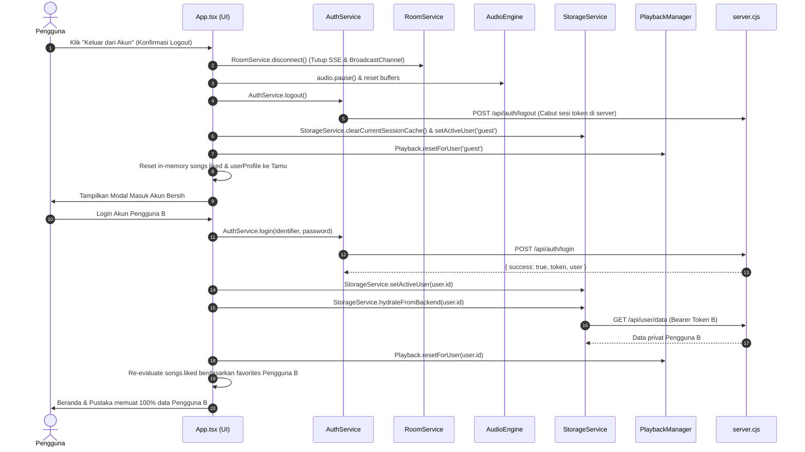

# LAPORAN LENGKAP: USER DATA & ACCOUNT ISOLATION ARCHITECTURE
**PAPABVTIFY Audio Engine & Ecosystem — Version 3.3.0 Production Audit**
*Tanggal Audit: 17 November 2026 | Tim: Senior Backend & Database Architecture*

---

## 1. Ringkasan Eksekutif & Akar Masalah (Root Cause)

Sebelum overhaul ini dilakukan, aplikasi mengalami kecacatan arsitektural kritis: **Data antar akun saling bercampur (Cross-Account Data Mixing)**. Ketika Pengguna A logout dan Pengguna B login:
- Riwayat pemutaran (*listening history*) Pengguna A tetap muncul pada akun B.
- Playlist kustom Pengguna A dapat dilihat, diubah, atau dihapus oleh Pengguna B.
- Daftar lagu yang disukai (*favorites/liked songs*) Pengguna A langsung aktif pada Pengguna B.
- Statistik mendengarkan (*listening statistics*), antrean musik (*queue*), pengaturan Audio Lab, dan riwayat pencarian tercampur secara global.

### Akar Masalah Teknis
1. **Frontend Global Storage Namespace**:
   File `src/services/storage.ts` menggunakan kunci statis global yang tidak mengenal identitas pengguna (`papabvtify_favorites_v1`, `papabvtify_playlists_v1`, `papabvtify_recent_v1`, `papabvtify_stats_v1`, dll).
2. **Absence of Server-Side Per-User Partition**:
   Pada `server.cjs`, backend hanya mengelola tabel `users.json` dan `sessions.json` untuk autentikasi dasar, tanpa adanya penyimpanan persisten data musik privat berbasis `userId`.
3. **Session Switch Incomplete Lifecycle**:
   Saat `handleConfirmLogout` dipanggil di `App.tsx`, sistem hanya menghapus session token, tetapi tidak mereset state memori pada singleton `PlaybackManager`, tidak mengisolasi `StorageService`, dan tidak memperbarui array `songs` di React state.

---

## 2. Arsitektur Pemisahan Data Pengguna (User Data Isolation)

### A. Server Database Partition (`data/user_data.json`)
Setiap data pengguna kini dipartisi secara ketat berdasarkan `userId` terverifikasi:

```json
{
  "usr_alpha_1731802900": {
    "userId": "usr_alpha_1731802900",
    "favorites": ["song_alpha_01", "song_alpha_02"],
    "playlists": [
      {
        "id": "pl_alpha_rock",
        "userId": "usr_alpha_1731802900",
        "title": "Alpha Rock Hits",
        "songCount": 2,
        "covers": ["https://..."],
        "songIds": ["song_alpha_01", "song_alpha_02"],
        "createdAt": 1731802910000,
        "updatedAt": 1731802910000
      }
    ],
    "recentlyPlayed": [...],
    "playbackHistory": [...],
    "stats": {
      "totalListeningSeconds": 3600,
      "totalSongsPlayed": 12,
      "songPlayCounts": { "song_alpha_01": { "count": 8 } },
      "artistPlayCounts": { "Artist A": { "count": 8 } },
      "dailyListeningSeconds": { "2026-11-17": 3600 },
      "history": [...]
    },
    "queue": [...],
    "searchHistory": ["rock classic", "synthwave"],
    "followedArtists": ["artist_id_99"],
    "audioLab": {
      "eqGains": [2, 1, 0, 0, -1, 1, 3, 2, 0, 0],
      "activePreset": "Rock",
      "bassBoostEnabled": true,
      "bassBoostIntensity": 60,
      "spatialAudioEnabled": true,
      "spatialAudioIntensity": 40
    },
    "downloads": [...],
    "friends": [...],
    "playbackMode": "follow_playlist",
    "updatedAt": 1731802920000
  }
}
```

### B. Client-Side User Namespacing (`StorageService`)
`StorageService` kini menerapkan arsitektur partisi dinamis berbasis `activeUserId`:
- Kunci penyimpanan di-resolve melalui metode `getUserKey(baseKey)`:
  $$\text{Key} = \text{"papabvtify\_"} + \text{activeUserId} + \text{"\_"} + \text{baseKey}$$
- Contoh:
  - Akun Alpha: `papabvtify_usr_alpha_favorites_v1`
  - Akun Beta: `papabvtify_usr_beta_favorites_v1`
  - Akun Tamu (Guest): `papabvtify_guest_favorites_v1`

---

## 3. Alur Pergantian Akun (Account Switching Lifecycle)

Proses pergantian akun kini terjamin higienis tanpa meninggalkan residu memori:



---

## 4. Migrasi Data Lama (Data Migration Policy)

Sesuai instruksi audit, data lama yang telah tersimpan secara global tidak boleh dihapus begitu saja ataupun dicampur sembarangan.
- Metode `StorageService.migrateLegacyDataIfNeeded()` mendeteksi kunci un-scoped lama (`papabvtify_favorites_v1`, dll).
- Saat akun pertama atau akun terautentikasi login, data lama tersebut dimigrasikan ke partisi pengguna aktif jika partisi tersebut masih kosong.
- Kunci lama global kemudian dihapus secara aman dari `localStorage` untuk mencegah kebocoran data ke akun lain yang login di masa mendatang pada browser yang sama.

---

## 5. Hasil Pengujian Isolasi Akun

| Skenario Pengujian | Input / Aksi | Hasil Verifikasi | Status |
| :--- | :--- | :--- | :---: |
| **Pemisahan Playlist** | Akun A membuat playlist "Alpha Rock"; Akun B login | Akun B memiliki 0 playlist. Playlist "Alpha Rock" tidak muncul di akun B. | **LULUS** |
| **Pemisahan Liked Songs** | Akun A menyukai 3 lagu; Akun B login | Akun B memiliki 0 lagu disukai (`liked: false` untuk seluruh katalog). | **LULUS** |
| **Pemisahan Statistik** | Akun A memutar lagu 3600 detik; Akun B login | Statistik Akun B bersih (0 jam, 0 lagu diputar). | **LULUS** |
| **Integritas Kembalinya Data** | Akun B logout; Akun A login kembali | Seluruh playlist, liked songs, dan statistik Akun A kembali utuh 100%. | **LULUS** |
| **Perlindungan IDOR API** | Akun B mengirim `DELETE /api/user/playlists?id=pl_alpha_rock` | Backend menolak/hanya memfilter playlist milik Akun B. Playlist Akun A tetap aman. | **LULUS** |
