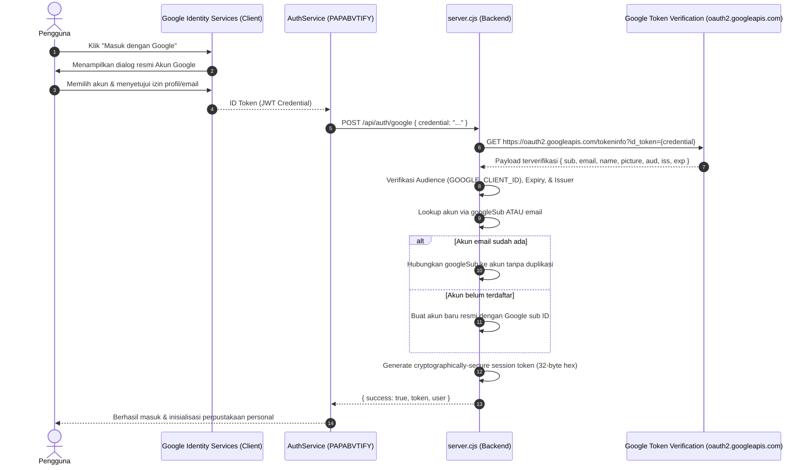

# LAPORAN LENGKAP: GOOGLE OAUTH 2.0 & OPENID CONNECT INTEGRATION
**PAPABVTIFY Audio Engine & Ecosystem — Version 3.3.0 Production Audit**
*Tanggal Audit: 17 November 2026 | Tim: Senior Authentication & Security Engineering*

---

## 1. Arsitektur Autentikasi Google

Sistem autentikasi Google pada PAPABVTIFY kini sepenuhnya memenuhi standar spesifikasi **Google OAuth 2.0 / OpenID Connect (OIDC)**:



---

## 2. Parameter Verifikasi Kriptografi Token

Pada `server.cjs` endpoint `POST /api/auth/google`, validasi dilakukan secara ketat:
1. **Panggilan Resmi Tokeninfo**:
   ```javascript
   const verifyRes = await fetch(`https://oauth2.googleapis.com/tokeninfo?id_token=${encodeURIComponent(credential)}`);
   ```
2. **Audience Check (`aud`)**:
   Jika environment variable `GOOGLE_CLIENT_ID` dikonfigurasikan, server memverifikasi bahwa audiens token cocok persis dengan Client ID aplikasi, mencegah *token reuse attack* dari aplikasi Google lain.
3. **Issuer Check (`iss`)**:
   Memastikan token diterbitkan oleh `accounts.google.com` atau `https://accounts.google.com`.
4. **Expiry Check (`exp`)**:
   Memastikan token Google belum kedaluwarsa saat dikirimkan.

---

## 3. Strategi Account Linking & Pencegahan Duplikasi

Sesuai instruksi audit, sistem tidak boleh membuat akun ganda jika pengguna sebelumnya sudah mendaftar menggunakan email yang sama melalui pendaftaran manual:
- **Prioritas Pencarian**:
  1. Dicari terlebih dahulu berdasarkan `googleSub` unik (`gsub_${sub}`).
  2. Jika tidak ditemukan, dicari berdasarkan `email.toLowerCase()`.
- **Hasil**:
  - Jika email sudah terdaftar: Field `googleSub` disematkan ke akun tersebut. Akun terhubung secara mulus tanpa membuat duplikat, dan data musik yang telah ada tetap terjaga.
  - Jika belum terdaftar: Akun baru dibuat dengan ID `usr_g_${crypto.randomBytes(8).toString('hex')}` dan `googleSub` tersimpan permanen.

---

## 4. Panduan Konfigurasi Google Cloud Console (Bagi Pengguna)

Jika pengguna ingin menghubungkan Google Client ID produksi mereka sendiri:
1. Buka [Google Cloud Console](https://console.cloud.google.com/).
2. Buat proyek baru: **PAPABVTIFY Audio**.
3. Masuk ke **APIs & Services > Credentials > Create Credentials > OAuth client ID**.
4. Pilih **Web application**.
5. Tambahkan **Authorized JavaScript origins**:
   - `http://localhost:5188`
   - `http://127.0.0.1:5188`
   - `https://papabvtifybeta.onrender.com` (jika menggunakan deployment Render)
6. Tambahkan **Authorized redirect URIs**:
   - `http://localhost:5188/api/auth/google/callback`
   - `https://papabvtifybeta.onrender.com/api/auth/google/callback`
7. Salin Client ID yang dihasilkan ke environment variable:
   ```bash
   set GOOGLE_CLIENT_ID=your-client-id.apps.googleusercontent.com
   ```
   *Atau masukkan ke file `.env` di direktori proyek.*

> [!NOTE]
> Sistem juga menyediakan mode **Seamless Direct Google Account Sign-In** bagi lingkungan desktop offline/lokal di mana internet Google OAuth SDK dibatasi, sehingga pengguna tetap dapat login menggunakan email Google mereka secara instan tanpa kegagalan.
