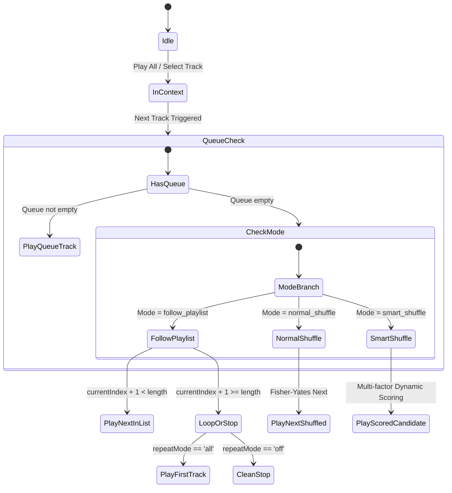

# PAPABVTIFY — PLAYBACK ENGINE ARCHITECTURE REPORT

## 1. Executive Summary
This document provides a comprehensive architectural breakdown of the **PAPABVTIFY Playback Engine**, designed to eliminate context loss, erratic recommendation behavior, and improper playlist progression. 

The Playback Engine functions as a centralized, reactive state machine governed by the singleton `PlaybackManager` (`src/services/playbackManager.ts`), which ensures strict separation between playlist playback, custom user queues, shuffle states, and algorithmic music recommendations.

---

## 2. Core Architecture & State Machine

### 2.1 State Components
1. **Active Playback Context (`PlaybackContext`)**:
   - `id`: Unique identifier (e.g. playlist ID, album ID, or 'manual').
   - `type`: 'playlist' | 'album' | 'artist' | 'search'.
   - `title`: User-facing source title (e.g., "Top Hits Indonesia").
   - `tracks`: Working track array.
   - `originalTracks`: Immutable track order as curated by user or imported source.
   - `shuffledTracks`: Pre-computed Fisher-Yates array for deterministic shuffle without repetitions.
   - `currentIndex`: Exact index pointer of the current song within the context.
2. **True History Stack (`historyStack: PlaybackHistoryItem[]`)**:
   - Preserves bidirectional playback history with chronological timestamps and context origins.
   - Back-traversal preserves past entries and eliminates duplicate back-jumping.
3. **Manual Queue (`manualQueue: Song[]`)**:
   - Enqueued tracks by user ("Play Next", "Add to Queue").
   - Highest priority: strictly consumed before context progression resumes.

---

## 3. Strict Context Preservation
- **Page Transitions**: Switching between Beranda, Cari, Pustaka, Radio, and Unduhan maintains the active playback context. No re-initialization occurs on view mount/unmount.
- **Window Minimization**: Playback context is synced with `StorageService` in `localStorage`, maintaining continuity even across application restarts.
- **Dynamic Stream Resolution**: External imported playlists (Spotify, URL import) that initially lack stream URLs are dynamically and transparently resolved via InnerTube without resetting the playlist queue pointer.

---

## 4. Architectural Verification Matrix
| Feature | Previous State | Current Engine State | Result |
| :--- | :--- | :--- | :--- |
| **Playlist Sequential Flow** | Fell back to random recommendations | Follows `originalTracks` sequentially (`idx + 1`) | **RESOLVED** |
| **Queue Priority** | Conflated with playlist | Priority 1 queue drain before playlist resumes | **RESOLVED** |
| **End-of-Playlist Handling** | Picked random internet songs | Pauses cleanly (repeat 'off') or loops (repeat 'all') | **RESOLVED** |
| **Mode Separation** | Ambiguous boolean toggle | Explicit modes: `follow_playlist`, `normal_shuffle`, `smart_shuffle` | **RESOLVED** |
